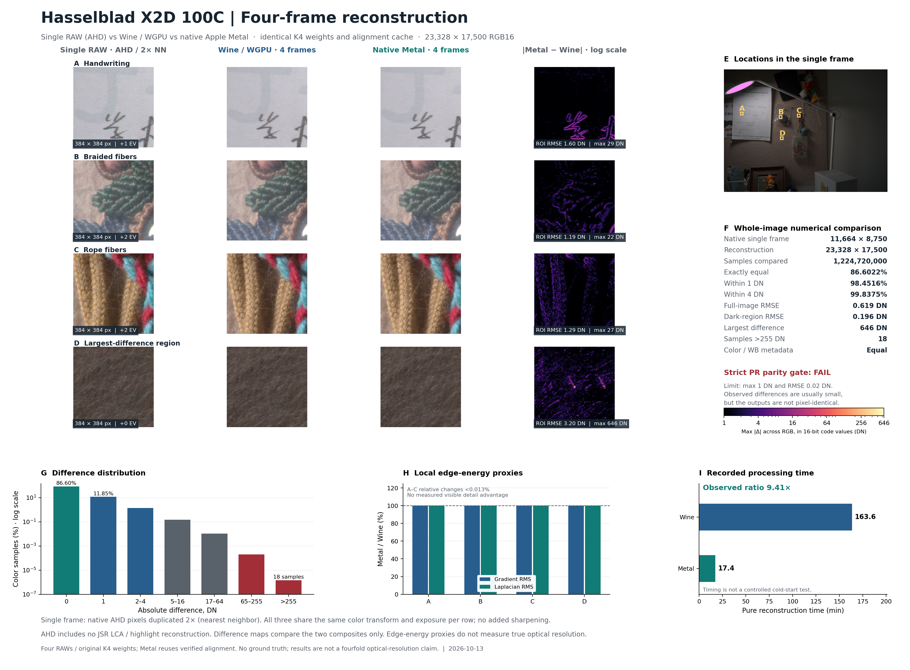
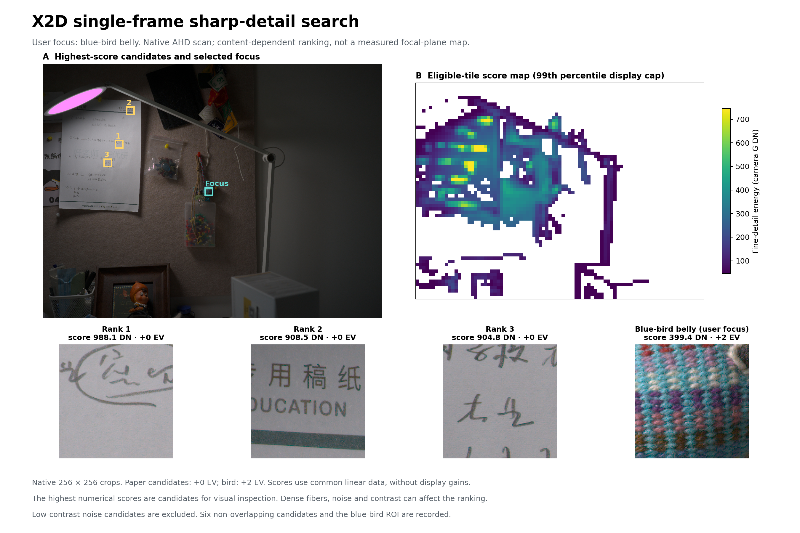

# X2D 四帧 JSR：原片、Wine 与 Metal 简要对比

更新：2026-10-13。第一代 Hasselblad X2D 100C 的同组四张 RAW，在 M1 Pro 16 GB 上完成电脑端离线对照；不是机内加速或本库 C 合成器验收。前序实拍见 [采集报告](PIXEL-SHIFT-CAPTURE-RESULTS.md)。

- 四帧相较单张 AHD 基线，可见彩色颗粒更少，文字和纤维更连续；没有真值，不能据此宣称四倍光学细节。
- Wine／WGPU 与原生 Metal 的可见精细度基本相当。全图 RMSE 为 0.619 DN，98.45% 的颜色样本差异≤1 DN；严格逐像素一致性未通过。
- 日志纯重建由 163.55 分钟降至 17.37 分钟，耗时比约 9.41。Metal 完整进程约 18.77 分钟并复用配准缓存，不是受控冷启动基准。
- 用户对焦点在蓝鸟腹部。原片细节扫描的首位候选为稿纸上方手写笔画 `(2496, 2624)`，右上印刷字也适合观察边缘；蓝鸟腹部进入有效窗口的前约 8%。该指标受反差、纹理和噪声影响，不能判断焦平面或对焦偏差。

## 三方局部对比

单张 AHD 以最近邻重复 2× 展示；同一行使用相同视野、色彩转换和曝光增益，没有另加锐化。单张缺少 JSR 色差／高光重建，属于整体路线对照。B 为圆形挂饰附近纤维，不是蓝鸟；第四列只比较两次合成。

## 原片细节候选与蓝鸟腹部

采用平滑后 DoG 截尾 RMS，256×256 原生窗口、128 像素步长，并排除暗、低反差及饱和区域。扫描 5,874 个窗口，1,788 个有效。纸张候选 +0 EV、蓝鸟 +2 EV 展示；分数使用共同的线性数据。新增位置只扫描原片，没有重新生成已删除的完整合成。

处理路线参考 [JSR PR #2](https://github.com/y-g-jiang/Jiangtherapee-Super-Resolution-World-Best/pull/2) 固定提交 `7294095eb2b40e62f3349734ccde7ce28cb32cec` 和 [PR #3](https://github.com/y-g-jiang/Jiangtherapee-Super-Resolution-World-Best/pull/3)。本地使用 Bridge 2.3.12 作兼容集成，未再分发第三方程序或模型。详细测量、矢量图及脚本留在本地；本库只收录摘要和两张研究图。完整 DNG、预览与大缓存已按用户要求删除，四份原始 RAW 校验未变化。
