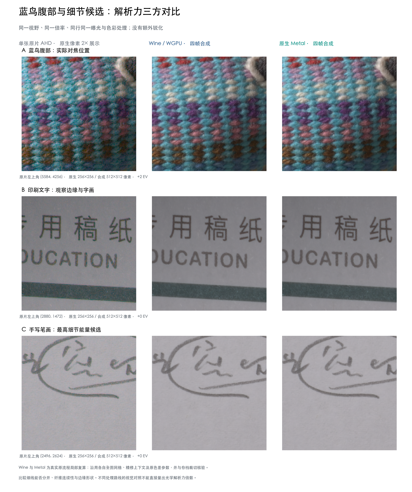
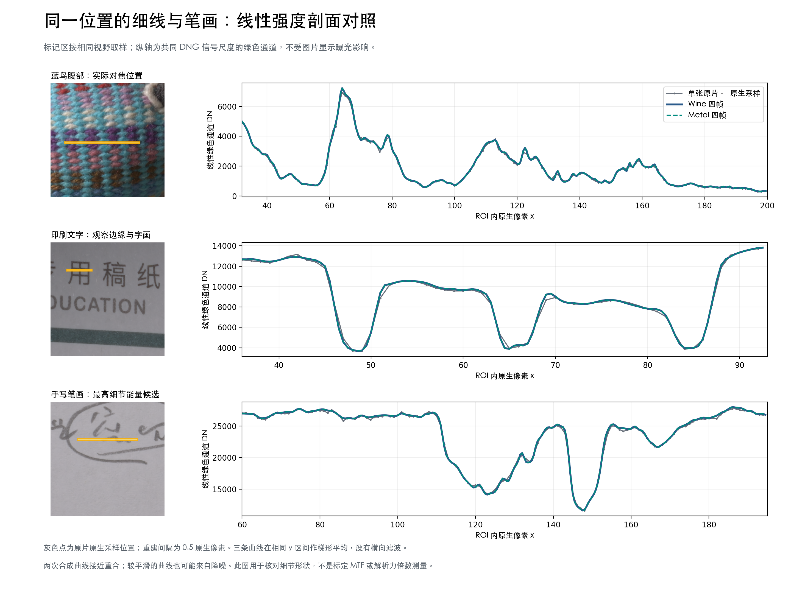

# X2D JSR：蓝鸟腹部与文字的解析表现

更新：2026-10-13。第一代 X2D 100C 同组四帧的电脑端离线对照。重点为用户实际对焦的蓝鸟腹部，以及细节候选的印刷字和手写笔画；前序实拍见 [采集报告](PIXEL-SHIFT-CAPTURE-RESULTS.md)。

- **Wine 与 Metal：** 三处局部的可见解析细节基本相同，线性强度剖面接近重合；共同显示处理后的 8-bit RGB 最大差异均为 1，没有发现哪一次分开了更多纤维或笔画。
- **四帧与单张：** 合成后的彩色颗粒和伪色更少，编织轮廓、字画更连贯，细节更容易辨认。绿色通道剖面的主要峰谷接近，未显示明显新增的一层可分辨结构；这组自然场景不支持几倍光学解析力的结论。
- **复算核验：** 完整成片此前已删除，因此按两次原流程、原全图网格和已保存色差参数重算局部及周边上下文。两后端各四个校验区域相对存档裁切的最大误差≤1 DN、RMSE≤0.004 DN。局部来自原 K4 模型与既定写出链，未另加锐化。

## 同位置三方局部对照

每格覆盖 256×256 原片像素／512×512 合成像素。单张为 AHD，原生像素最近邻重复 2×；同一行使用相同视野、色彩转换和曝光，没有另加锐化。单张与四帧是整体处理路线对照。

## 同位置强度剖面

灰点为单张原生采样，蓝线与绿线为两次四帧结果；使用线性绿色通道，在相同 y 区间作梯形平均，未进行横向滤波或按曲线拟合亮度。剖面用于核对细节形状，不是标定 MTF。

性能为次要记录：旧 Wine 纯重建 163.55 分钟，Metal 17.37 分钟；Metal 复用缓存，这不是受控冷启动基准。早期全图严格一致性门槛失败仍保留，局部吻合不代表全图逐像素相同。

来源为 [JSR PR #2](https://github.com/y-g-jiang/Jiangtherapee-Super-Resolution-World-Best/pull/2)（`7294095eb2b40e62f3349734ccde7ce28cb32cec`）及 [PR #3](https://github.com/y-g-jiang/Jiangtherapee-Super-Resolution-World-Best/pull/3)，本地 Bridge 2.3.12 兼容集成、原 K4 权重；未再分发第三方程序或模型。大库仅提供概括和两张 PNG，详细数据、SVG、脚本留在本地。四份原始 RAW 保持完整，仅保留局部实验记录并清理临时运行材料。
